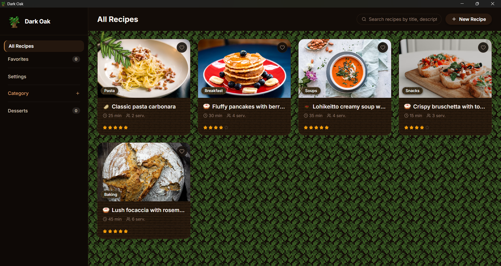

<div align="center">

# Dark Oak

<p align="center">
  <strong>A Minecraft Dark Oak themed recipe book with localization, auto-translation, and SQLite support</strong>
</p>



<br/>
<br/>
<br/>

<a href="https://skillicons.dev">
  
</a>

</div>

---

## About

**Dark Oak** is a desktop recipe manager designed in the cozy aesthetic of Minecraft's Dark Oak wood. It allows you to organize, create, and save your recipes locally.

## Key Features

- **Custom Pixel-Art Icons**: Extensive collection of pixel art icons for ingredients, dishes, and actions with smart auto-detection.
- **Automatic Recipe Translation**: Switch between Russian and English on the fly. Recipes, cooking units, categories, and instructions are automatically translated and cached locally in SQLite for offline use.
- **Reliable SQLite Database**: All data is stored in a fast local SQLite database (`dark-oak-recipes.db`) with automatic migration and JSON backup sync.
- **In-App GitHub Updates**: Built-in auto-updater that checks for new releases on GitHub, downloads updates in the background, and installs them.
- **Interactive Servings Multiplier**: Adjust portion counts with automatic ingredient scaling.

## Download & Installation

Download the latest version for Windows from the [GitHub Releases](https://github.com/MarzVoid/Dark-Oak/releases) page:

1. Open the [Releases](https://github.com/MarzVoid/Dark-Oak/releases) tab.
2. Download the latest executable setup file (`Dark Oak Setup x.x.x.exe`).
3. Run the setup and enjoy cooking with Dark Oak.

## Getting Started

### Prerequisites

- Node.js (v18 or newer)
- Git

### Running Locally

1. Clone the repository:
   ```bash
   git clone https://github.com/MarzVoid/Dark-Oak.git
   ```

2. Navigate to the project directory:
   ```bash
   cd Dark-Oak
   ```

3. Install dependencies:
   ```bash
   npm install
   ```

4. Launch the application in development mode:
   ```bash
   npm run dev
   ```

### Building

To package and build an executable installer for Windows:
```bash
npm run dist
```

## Contributing

Contributions, issues, and feature requests are very welcome.

1. Fork the repository
2. Create your feature branch (`git checkout -b feature/your-feature`)
3. Commit your changes (`git commit -m "Add feature"`)
4. Push to the branch (`git push origin feature/your-feature`)
5. Open a Pull Request

Feel free to open an issue in the [Issues](https://github.com/MarzVoid/Dark-Oak/issues) tab if you have suggestions or want to report a bug.
